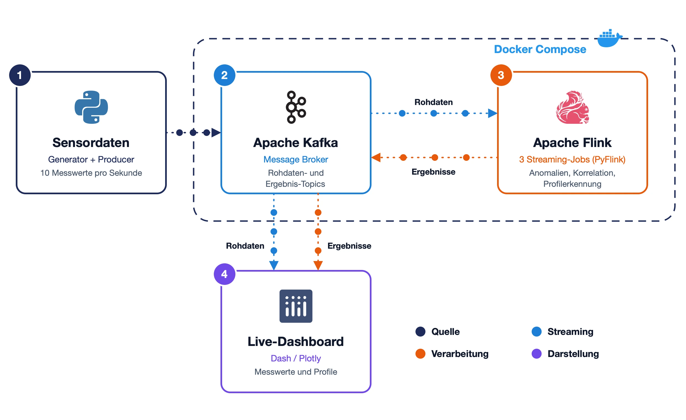

# Echtzeit-Prozessüberwachung einer Draht-Härtelinie

Diese Streaming-Pipeline überwacht die Sensordaten einer Draht-Härtelinie in Echtzeit. Die Messwerte laufen über Apache Kafka in drei Apache-Flink-Jobs. Sie melden Temperatur-Anomalien, verfolgen den Einfluss der Liniengeschwindigkeit auf die Härtetemperatur und erkennen fehlerhafte Drahtprofile, solange der Draht noch durch die Anlage läuft. Ein Live-Dashboard zeigt die Ergebnisse.


## Inhaltsverzeichnis

- [Überblick](#überblick)
- [Architektur](#architektur)
- [Voraussetzungen](#voraussetzungen)
- [Setup](#setup)
- [Projektstruktur](#projektstruktur)
- [Entstehung](#entstehung)

## Überblick

### Ausgangslage

Ein Automobilzulieferer fertigt Fahrwerksfedern aus gehärtetem Draht. Diese Pipeline überwacht die Verarbeitung des Drahtes laufend, damit nur korrekte Bauteile entstehen. Fehler sollen nicht erst bei der Prüfung nach der Produktion auffallen.

Die Daten sind synthetisch, nach dem Vorbild realer Prozessdaten erzeugt. Darin sind gezielt Anomalien angelegt, damit sich prüfen lässt, ob die Pipeline sie erkennt.

### Mehrwert der Pipeline

#### Temperatur-Anomalien erkennen

Beim Härten und Anlassen muss die Temperatur stabil bleiben. Weicht ein Messwert ungewöhnlich stark ab, meldet die Pipeline das sofort. So kann die Linie eingreifen, bevor weiterer Draht falsch gehärtet wird.

#### Geschwindigkeit und Temperatur monitoren

Läuft der Draht schneller durch die Anlage, wird er weniger lange erhitzt, und die Härtetemperatur sinkt. Die Pipeline prüft laufend, ob dieser Zusammenhang besteht. Bricht er weg, kann das auf ein Problem an der Anlage hindeuten.

#### Fehlerhafte Drahtprofile erkennen

Der Draht hat keinen gleichmäßigen Durchmesser. Er wechselt in einem festen Muster zwischen dünn und dick: dünn, ansteigend, dick, abfallend. Dieses Muster heißt Profil und wiederholt sich fortlaufend. Die Pipeline vermisst jedes Profil, sobald es durch die Anlage gelaufen ist, und kennzeichnet es als fehlerhaft, wenn ein Abschnitt zu lang oder zu kurz ist. So können fehlerhafte Abschnitte aussortiert werden, bevor sie weiterverarbeitet werden.


## Architektur



1. **Sensordaten:** Ein Generator erzeugt die Messwerte, ein Producer spielt sie im Takt der Anlage nach Kafka.
2. **Apache Kafka:** Nimmt die Rohdaten auf und speichert die Ergebnisse der Jobs in eigenen Topics.
3. **Apache Flink:** Drei Streaming-Jobs lesen die Rohdaten und werten sie laufend aus: Temperatur-Anomalien, Korrelation von Geschwindigkeit und Temperatur, Profilerkennung.
4. **Live-Dashboard:** Liest Rohdaten und die von Flink erkannten Profile aus Kafka und zeigt sie, während die Daten eintreffen.

Kafka und Flink laufen per Docker Compose in Containern; Producer und Dashboard starten lokal.

## Voraussetzungen

- [uv](https://docs.astral.sh/uv/) (installiert Python 3.13 selbst)
- [Docker](https://docs.docker.com/get-docker/) mit Docker Compose
- `make`

## Setup

1. Repository klonen und Abhängigkeiten installieren.
   ```bash
   git clone https://github.com/ericjoelr/echtzeit-prozessueberwachung.git
   cd echtzeit-prozessueberwachung
   uv sync
   ```
2. Kafka und Flink starten und die drei Jobs abschicken. Beim ersten Mal wird das Flink-Image gebaut, das dauert einige Minuten.
   ```bash
   make up
   ```
3. Sensordaten einspielen und das Dashboard starten. Beim ersten Aufruf werden 60 Minuten Testdaten erzeugt und mit 10-facher Geschwindigkeit abgespielt, also in rund 6 Minuten. Strg+C beendet beides.
   ```bash
   make run
   ```
4. Dashboard öffnen: http://localhost:8050 (Flink-Oberfläche: http://localhost:8081)
5. Alles wieder beenden.
   ```bash
   make down
   ```

## Projektstruktur

```
.
├── src/
│   ├── ingestion/
│   │   ├── generate_data.py                 Synthetische Sensordaten mit angelegten Anomalien
│   │   └── producer.py                      Spielt die Daten im Takt der Anlage nach Kafka
│   ├── transform/                           Flink-Jobs (laufen im Container)
│   │   ├── threshold_alerts.py              Temperatur-Anomalien
│   │   ├── correlation.py                   Korrelation von Geschwindigkeit und Temperatur
│   │   ├── profile_detection.py             Profilerkennung: Flink-Hülle mit Zustand pro Maschine
│   │   └── profile_classification_logic.py  Fachlogik der Profilerkennung, ohne Flink testbar
│   └── serving/
│       ├── dashboard.py                     Live-Dashboard
│       └── consumer.py                      Gibt ein Kafka-Topic aus, z. B. die Alarme
├── notebooks/                               Explorative Analysen, aus denen die Job-Parameter stammen
├── tests/                                   pytest: Fachlogik der Profilerkennung
├── docker-compose.yml                       Kafka sowie Flink-Job- und Taskmanager
├── Dockerfile                               Flink-Image mit PyFlink und Kafka-Connector
├── Makefile                                 up, run, down; außerdem data, test, lint
└── pyproject.toml                           Abhängigkeiten und Tool-Konfiguration (uv, ruff, pytest)
```

## Entstehung

Entstanden als Studienprojekt im Modul *In-Memory Computing* (2026) nach einer Aufgabenstellung eines Automobilzulieferers. Die echten Prozessdaten sind nicht Teil dieses Repos.
